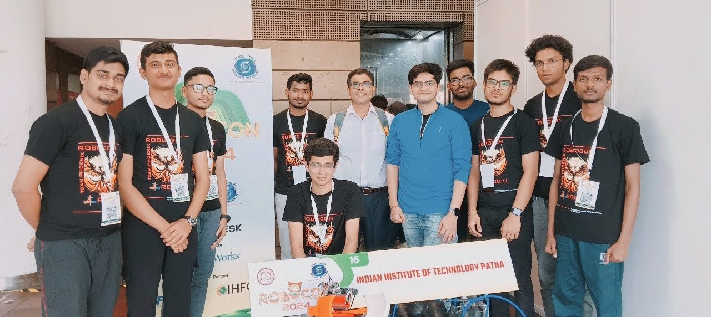
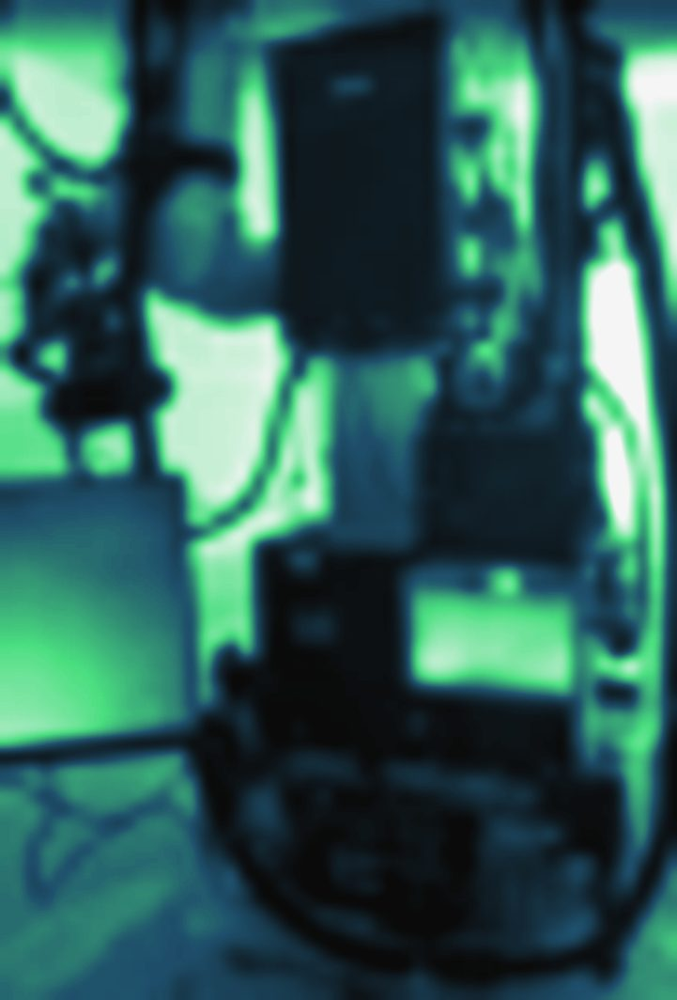

# Panav

<p align="center">
  
</p>

Robotics portfolio & blog. <span style="color:#B22222">Blood red theme.</span>

<p align="center">
  
  
  
</p>

## Run Locally

```bash
npm install
npm run dev
```

Open `http://localhost:3000`.

---

<p align="center">
  Co-authored with <a href="https://github.com/nemoclaw">nemoclaw</a>
</p>
